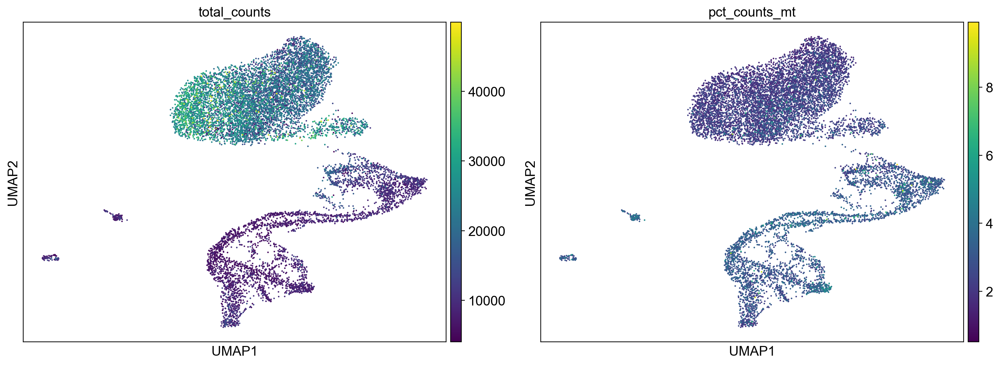
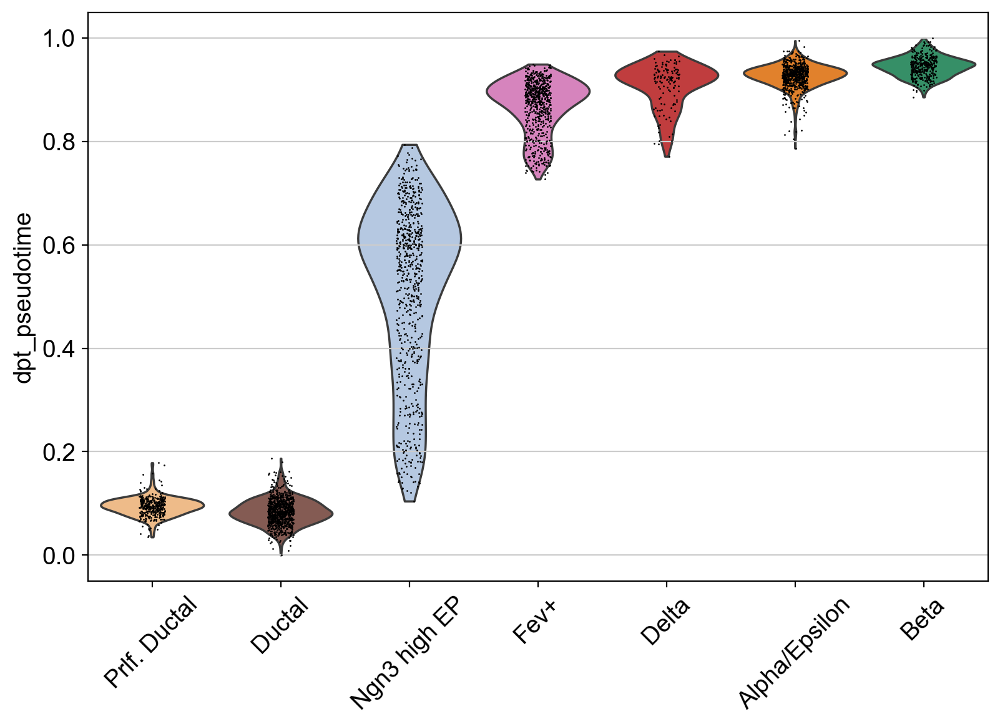

# Single-cell re-analysis of mouse pancreatic endocrinogenesis (E15.5) with Scanpy

An independent re-analysis of the E15.5 stage of the mouse pancreas scRNA-seq dataset from
Bastidas-Ponce et al. (2019), starting from the raw count files on GEO and going through quality
control, clustering, cell-type annotation and PAGA trajectory inference.

The code was written from scratch in Python (Scanpy, Jupyter) rather than reusing the authors'
notebook, so that the results could be checked independently against the published findings.

## Data

- **Study:** Bastidas-Ponce A, Tritschler S, Dony L, et al. *Comprehensive single cell mRNA profiling
  reveals a detailed roadmap for pancreatic endocrinogenesis.* Development 146(12): dev173849 (2019).
- **GEO accession:** [GSE132188](https://www.ncbi.nlm.nih.gov/geo/query/acc.cgi?acc=GSE132188)
- **Sample used here:** E15.5 (embryonic day 15.5)
- **Input format:** raw 10x-style count files (matrix, genes, barcodes)
- **Published labels:** the authors' processed file on GEO (`GSE132188_adata.h5ad`), used only to
  compare my clusters with their cell-type labels

The data are not included in this repository. Download the E15.5 files from GEO and place them in
`data/raw/` before running the notebook; the notebook downloads the authors' processed file itself.

## Workflow

1. **Load data:** read the raw count matrix, gene list and cell barcodes into an AnnData object.
2. **Quality control:** compute per-cell metrics (genes detected, total counts, mitochondrial
   fraction) and filter low-quality cells and rarely detected genes.
3. **Normalisation:** library-size normalisation and log transformation.
4. **Feature selection:** identify highly variable genes (HVGs).
5. **Dimensionality reduction:** PCA, then a nearest-neighbour graph and UMAP for visualisation.
6. **Clustering:** Leiden clustering on the neighbour graph.
7. **Annotation:** match each cell to its published label in the authors' processed file, then name
   each Leiden cluster by the label most of its cells carry, recording what fraction of cells agree.
8. **Trajectory inference:** PAGA (partition-based graph abstraction) on the ductal and endocrine
   clusters, to estimate how they connect along endocrine differentiation.

## Results

- **Quality control:** 11,372 cells and 16,175 genes remained after filtering.
- **Clustering and annotation:** Leiden clustering gave 18 clusters (0–17). Named by their majority
  published label, they cover mature acinar, ductal, proliferating ductal, Ngn3-high endocrine
  progenitors, Fev+ endocrine cells, and alpha/epsilon, beta and delta cells.
- **Agreement with the paper:** of the 14 clusters made up of published cell types, 9 were at least
  85% one label. The 5 mixed clusters (Fev+, alpha, delta, ductal, proliferating ductal; 53–71%
  agreement) lie along the continuous ductal-to-endocrine path, where neighbouring states blend into
  each other. Mature acinar cells split into 7 clusters. Four clusters (9, 14, 15, 17) are made of
  cells with no label in the published annotation, most likely cells the authors removed in their own
  filtering.
- **Trajectory (PAGA):** on the ductal and endocrine clusters, PAGA connected ductal cells to
  Ngn3-high endocrine progenitors, then to Fev+ cells, which branched towards beta, delta and
  alpha/epsilon cells. This matches the endocrine differentiation route described in the paper.
- **Not resolved at this stage:** alpha and epsilon cells were not separated, and Ngn3-low
  progenitors did not form a distinct cluster.







## Repository structure

```
.
├── notebook/
│   └── e15_5_analysis.ipynb   # full analysis, step by step
├── figures/                   # exported plots used in this README
├── data/
│   └── raw/                   # place the GEO E15.5 files here (not tracked)
└── README.md
```

## How to run

Requires Python 3 and these packages:

```bash
pip install scanpy anndata leidenalg matplotlib pandas numpy jupyterlab
```

Then start Jupyter and open `notebook/e15_5_analysis.ipynb`:

```bash
jupyter lab
```

## Limitations and next steps

- Only the E15.5 sample is analysed so far; the full study covers E12.5, E13.5, E14.5 and E15.5.
- Next: integrate all four time points and compare the combined trajectory with the published
  developmental roadmap.

## Author

**Moumita Bairagi** · [LinkedIn](https://www.linkedin.com/in/moumita-bairagi-11044982)
